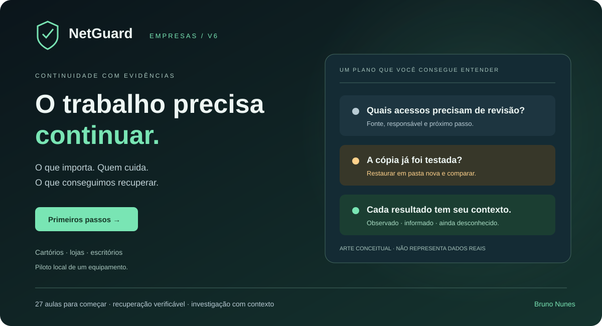

# NetGuard Lab — NetGuard Empresas

**Seu trabalho precisa continuar. Identifique o que importa, revise acessos e teste o que consegue recuperar.**



[**Experimentar o NetGuard**](https://netguard-lab.brdsnunes.chatgpt.site/) · [**Começar a aprender**](https://netguard-lab.brdsnunes.chatgpt.site/#aprender) · [**Instalar o piloto no VS Code**](docs/PRODUTO_E_PILOTO.md#primeiro-teste-no-vs-code-documentos-fictícios) · [**ZIP do código**](https://github.com/bruno-dsn/netguard-lab/archive/refs/heads/main.zip)

A edição **6.0** cria um piloto local de continuidade para **cartórios, lojas e escritórios**, acompanhado de uma entrada para quem ainda está aprendendo. O site público demonstra com dados fictícios. O programa local usa login, SQLite e as fontes configuradas de **um equipamento**. Necessidades e oferta comercial ainda precisam de validação com clientes.

## O que você pode fazer agora

| Área | Entrega concreta | Tipo de evidência |
| --- | --- | --- |
| Sua empresa | Perfil, inventário, responsável, RPO/RTO e próximos passos | Informações locais do responsável |
| Revisões | Contas/MFA, manutenção, suporte remoto, cópia externa e resposta | Histórico manual; revisão favorável vence em 30 dias |
| Recuperação | Copiar arquivos de pastas escolhidas, restaurar em pasta nova e comparar SHA-256 | Bytes observados, referência, resultado e tempo parcial |
| Acompanhamento | Fontes locais, mudanças, check-up e investigação por item | Observações com cobertura e limites explícitos |
| Relatório | HTML legível para leitura/impressão e JSON do recorte | Estado, fontes, responsáveis, testes e limitações |
| Fundamentos | 27 aulas em nove assuntos, explicação em etapas e progresso exportável | Registro de estudo autodeclarado |
| Empresa Viva | Nove missões avançadas e portal HTTP corrigido | Modelos, Python e HTTP distinguidos por origem |

O painel mostra **desconhecido** quando não há evidência suficiente. Revisões manuais e resultados observados são diferenciados. Uma cópia sem teste pede atenção; mudar as pastas invalida a avaliação da cópia anterior para o novo escopo. Falha conhecida de recuperação aparece como problema. Eventos em investigação continuam pendentes até uma decisão de reconhecimento.

Não há pontuação geral “seguro”, proteção completa, certificação ou declaração automática de conformidade. O diferencial proposto é **traduzir evidência em decisão compreensível e demonstrar recuperação com o responsável pelo trabalho**. Veja [necessidades por perfil, roteiro, critérios de aceite e caminho comercial](docs/PRODUTO_E_PILOTO.md).

## Primeiro teste local

Python **3.12+**, somente biblioteca padrão para este piloto. Abra a pasta do projeto no VS Code. No Mac/Linux, troque `python` por `python3` quando necessário.

```bash
python netguard_operations.py init --username operador --alias "PC de teste"
python netguard_operations.py configure --watch "data/piloto"
python netguard_operations.py serve
```

Crie sua senha no terminal, sem senha padrão. Abra **http://127.0.0.1:8787/index.html**. Em Recuperação, crie uma cópia dos documentos fictícios incluídos e clique **Restaurar e comparar**. Confira a pasta nova informada. Depois edite somente o documento fictício original e investigue a mudança em Operações.

Estado fica em `~/NetGuard-Operations`, fora do Git. O processo coleta enquanto ele e o computador estiverem ligados; Ctrl+C encerra. Não instala serviço permanente. `Iniciar-NetGuard-Empresas.cmd` inicia no Windows depois do init/configure. Não selecione documentos de clientes no primeiro teste.

Até **8 pastas, 1.000 arquivos, 10 MiB por arquivo e 50 MiB por cópia**; dez cópias e vinte testes por instalação, sem exclusão automática. Cópia local sem criptografia própria/offline, snapshot transacional, restauração de sistema ou varredura antimalware. O teste confirma bytes nesse recorte; validar conteúdo, aplicação e retorno do serviço continua necessário. Não sobrescreve o trabalho atual. [Fronteiras e limites](docs/PRODUTO_E_PILOTO.md#limites-da-recuperação).

## Estou começando e não entendi o laboratório

Abra [**Comece a aprender**](https://netguard-lab.brdsnunes.chatgpt.site/#aprender). São 27 aulas em segurança, Linux/shell, Python/algoritmos, objetos/automação, redes, reconhecimento, infraestrutura, desenvolvimento web e segurança de aplicações. Cada aula começa com uma ideia simples, aprofunda e pede uma previsão. Só depois avance para os casos Empresa Viva.

Quatro exercícios Python reais com fixtures fixas:

```bash
python aprender_fundamentos.py logs
python aprender_fundamentos.py ip
python aprender_fundamentos.py classes
python aprender_fundamentos.py hash
```

[Guia dos fundamentos e exercícios](docs/FUNDAMENTOS.md). Conteúdo autoral, sem copiar livro ou curso e sem afiliação à Solyd. A formação profunda de redes continua no [Rede em Movimento](https://github.com/bruno-dsn/rede-em-movimento).

## Verificação

A suíte Python cobre fontes, regras, servidor HTTP, sessão/CSRF, arquivos temporários, recusa de limites/links, validade, troca de escopo e recuperação preservando originais. A suíte web cobre demonstração sem API, formulários, explicações por etapas, saída escapada, relatórios e encerramento de sessão. CI Windows inclui recuperação local. Fluxos DOM não substituem inspeção visual em navegador, revisão independente ou uso com clientes.

```bash
python -m pip install -r requirements-dev.txt
python -m ruff check .
python -m pytest
cd web
npm ci --ignore-scripts
npm test
```

As dependências acima são para verificar a suíte completa, incluindo o Streamlit anterior; não são necessárias para iniciar o novo piloto operacional.

---

## Empresa Viva: laboratório avançado preservado

**Aprenda segurança investigando uma empresa fictícia: observe, corrija, teste de novo e explique com evidências.**

[Abrir Empresa Viva](https://netguard-lab.brdsnunes.chatgpt.site/empresa-viva.html) · [Primeiro uso e missões](docs/EMPRESA_VIVA.md) · [Operações](docs/OPERACOES.md) · [Estudos anteriores](https://netguard-lab.brdsnunes.chatgpt.site/estudos.html)

A versão **5.1** amplia a entrada do NetGuard numa jornada de estudo. Na Aurora Serviços, **empresa fictícia**, dois clientes abrem chamados e uma administradora tem funções específicas. Você investiga erros de login, acesso a recursos alheios e autorização administrativa; compara a aplicação antes/depois e resolve um caso diferente.

O núcleo Empresa Viva 1.1 tem nove missões, incluindo seis exercícios inspirados nos livros enviados pelo autor. Não é curso oficial da Solyd, certificação, incidente real, experiência profissional ou produto empresarial validado. A grade e os livros fornecidos pelo autor inspiraram assuntos; casos e conteúdo são originais. [Leitura orientada e limites de cada prática](docs/LIVROS_E_PRATICA.md).

## O que está implementado

| Área | O que você pode fazer |
|---|---|
| Empresa | Entender contas, chamados e decisões num mapa de serviços didático |
| Missões | Nove missões, hipóteses, pré-requisitos, dicas progressivas e investigação por evento |
| Portal local | Login/logout, consultar/criar chamados e verificar papel administrativo no servidor corrigido |
| Investigação | Filtrar conta, recurso, origem, categoria e horário; abrir evidências e alternar usuário/aplicação/analista |
| Reprodução | Pausar/repetir registros existentes; reiniciar cria outro episódio e preserva o anterior |
| Correção | Comparar trechos do código, resultados e casos de transferência; testar escolhas no modelo |
| Livros e prática | Encontrar os capítulos pertinentes e abrir seus exercícios originais |
| Relatório | Citar IDs de eventos e registrar observação, alternativa, correção, limites e próximo passo |
| Progresso | Reabrir episódios/relatórios da própria conta; trilhas futuras identificadas como planejadas |
| Integração anterior | Exportar CSV de autenticação compatível com o analisador do NetGuard |

### As nove missões

1. **Falha de senha ou tentativa repetida?** Caso legítimo e sequência controlada; antes/depois de um orçamento temporário no servidor. Um alerta não confirma invasão.
2. **Um chamado que não é seu.** Autenticação não substitui autorização por proprietário. Testes de anônimo, dono, outro cliente e administradora.
3. **O botão sumiu. A permissão também?** Função administrativa verifica papel no servidor, antes de alterar o recurso. Esconder um botão não aplica autorização.

4. **Quem pode ler o arquivo financeiro?** Nove bits de permissão, dono/grupo/outros e preservação do trabalho autorizado. Modelo explícito, sem teste do SO.
5. **A busca trouxe dados de outro cliente.** Consulta concatenada versus parâmetros em SQLite de memória; busca legítima com apóstrofo.
6. **O comentário deve ser texto.** Saída textual e contexto; marcador sempre inerte na interface.
7. **O que mudou desde o último registro?** Hashes, criação/alteração/exclusão e conteúdo da mudança aprovada.
8. **Conter sem apagar a investigação.** Responsável, alcance, preservação e critérios de retorno; somente planos.
9. **Um IP, duas explicações.** Manutenção registrada, atividade a revisar e limites da atribuição.

Cada missão tem um caso de transferência. As novas mudam proprietário/grupo, entrada SQL, marcador HTML, bytes aprovados, critério de recuperação ou contexto do log. A explicação precisa funcionar além do primeiro exemplo.

**Faça sua correção:** altere bits ou escolha uma decisão e verifique o caso guiado ou diferente. O modelo confere acesso indevido e trabalho legítimo; as escolhas ficam na memória da página. Preserve sua explicação no relatório. [Roteiro dos livros](docs/LIVROS_E_PRATICA.md).

## Demonstração e execução real são experiências distintas

- **Site público:** modelo JavaScript com dados fictícios, sempre rotulado. Sem login real, acesso ao computador, alvos externos ou endpoints vulneráveis. Notas ficam em memória; exporte antes de fechar.
- **Portal local:** serviço corrigido em **127.0.0.1:8790**, com sessão, CSRF e SQLite por instalação. Chamados e ações realmente executam em HTTP local.
- **Episódios locais:** Python executa funções das variantes antes/depois em dados de memória separados. SQL realmente usa SQLite; HTML é transformado em texto; SHA-256 é calculado de bytes preparados. Permissões, resposta e atribuição continuam sendo modelos. **Não abre servidor para a variante vulnerável** e não recebe código, shell, URL ou destino arbitrário.
- **Replay:** reproduz registros existentes; não é nova solicitação. Eventos observados no Python, observados no portal, simulados e derivados preservam sua origem.

O hash identifica a versão dos módulos, sem assinatura ou prova de origem. Um teste que passa comprova apenas o comportamento coberto. Login e arquivo exportado não substituem criptografia de disco.

## Executar no VS Code

Baixe o ZIP ou clone:

```bash
git clone https://github.com/bruno-dsn/netguard-lab.git
cd netguard-lab
```

Requer **Python 3.12+**. No Mac/Linux, use `python3`; no Windows, `python`. Empresa Viva usa apenas a biblioteca padrão, sem pip, Docker, Node, API paga ou conta externa para funcionar.

```bash
python3 netguard_empresa_viva.py init
python3 netguard_empresa_viva.py serve
```

`init` solicita senhas próprias para `lia`, `rafa` e `admin` no terminal protegido. **Não há senha padrão.** Abra **http://127.0.0.1:8790/**. Ctrl+C encerra; dados ficam em `~/NetGuard-Empresa-Viva`, fora do repositório. No Windows, após init, `Iniciar-Empresa-Viva.cmd` inicia o serviço. Se não houver entrada protegida de senha, init recusa o fallback que poderia exibir a senha.

[Guia detalhado: instalação, missões, reset e encerramento](docs/EMPRESA_VIVA.md).

### Executar um caso sem interface

```bash
python3 netguard_empresa_viva.py run --mission ownership
python3 netguard_empresa_viva.py run --mission ownership --transfer
python3 netguard_empresa_viva.py verify
```

`verify` compara 18 episódios com 160 verificações de comportamento. O resultado inclui JSON de evidências, configuração e hash do código. [Exemplos observados gravados](data/empresa-viva/README.md) são gravações de execução, não solicitações realizadas ao abri-los.

## Operações e estudos anteriores

**Operações v4 continua disponível:** monitor local, alterações de arquivos autorizados, TCP/autenticação conforme fonte, investigação por item, pacote de evidências e contenção Windows **manual/opcional**. Possui autenticação e processo próprios em 127.0.0.1:8787. [Instalação, cobertura e recuperação](docs/OPERACOES.md).

[Estudos anteriores](https://netguard-lab.brdsnunes.chatgpt.site/estudos.html) conserva proteção inicial, inventário, logs, caso financeiro, método de defesa, revisão Wi-Fi/roteador e check-up. O arquivo de entrada passa a ser `web/estudos.html`; [histórico da versão 4](docs/HISTORICO_V4.md).

O [Rede em Movimento](https://github.com/bruno-dsn/rede-em-movimento) permanece projeto separado para revisão de redes. Recebeu em paralelo a edição 4, com formação do sinal ao serviço; continua separado deste produto.

## Testes

Somente Empresa Viva, sem instalar bibliotecas:

```bash
python3 -m unittest discover -s tests -p 'test_empresa_viva*.py' -v
```

Suíte completa do NetGuard, incluindo a edição Streamlit anterior:

```bash
python3 -m pip install -r requirements-dev.txt
python3 -m ruff check .
python3 -m pytest
cd web
npm ci --ignore-scripts
npm test
```

As versões de desenvolvimento estão fixadas; Node compatível com `web/package.json` (CI usa 24). CI verifica Python 3.12/3.13, interface e jobs Windows. O novo job Windows executa os testes do portal e dos cenários em memória, sem criar alvos vulneráveis em rede ou alterar firewall.

A validação cobre autorização em chamadas HTTP diretas, sessão/expiração/logout, CSRF/Host/Origin, acesso entre usuários, vínculo de evidências, escaping, reset, orçamento e distinção das origens. Testes DOM não substituem inspeção visual em navegador. [Resultados e pendências](PROGRESS.md).

## Arquitetura, segurança e expansão

[Arquitetura e modelo de ameaça](docs/ARQUITETURA_EMPRESA_VIVA.md) · [Auditoria de segurança](docs/AUDITORIA_EMPRESA_VIVA.md) · [Trilhas e critérios](docs/ROADMAP_EMPRESA_VIVA.md)

Permissões em modelo, SQL em memória, saída HTML e análise de bytes preparados já têm exercícios. Shell e permissões em Linux real, reconhecimento dedicado, XSS ativo em navegador isolado, upload, ML, LLMs, Wi-Fi e hardware continuam no roteiro. Docker não está disponível neste ambiente; não se promete isolamento equivalente a contêiner/VM. [O que foi entregue e o que depende de infraestrutura](docs/ROADMAP_EMPRESA_VIVA.md).

A plataforma local é um laboratório de estudo, não servidor público ou suíte de proteção empresarial. Uma organização fictícia por instalação; não há multitenancy, cadastro aberto, recuperação de senha ou gestão de frota.

## Organização

```text
netguard_empresa_viva.py   entrada CLI e processo local corrigido
empresa_viva/             identidade, portal, cenários, persistência e relatórios
web/index.html            NetGuard Empresas e fundamentos
web/empresa-viva.html     laboratório avançado preservado
src/netguard/business.py  perfil, revisões, cópias e recuperação
aprender_fundamentos.py   exercícios Python de fixtures fixas
web/estudos.html          experiência de estudo anterior
web/operations.html       área de Operações
web/data/                 catálogos e dados estáticos fictícios
data/empresa-viva/         gravações observadas e resultado de verificação
docs/                     guias, arquitetura, auditoria e roteiro
tests/                    verificações Python; web/tests contém testes DOM
```

Leia [CONTRIBUTING](CONTRIBUTING.md) e use apenas dados sintéticos nas contribuições. O código mantém a licença do repositório; conteúdo de cursos e identidades visuais de terceiros não são incorporados. Referências técnicas são apoio e não certificação OWASP.
