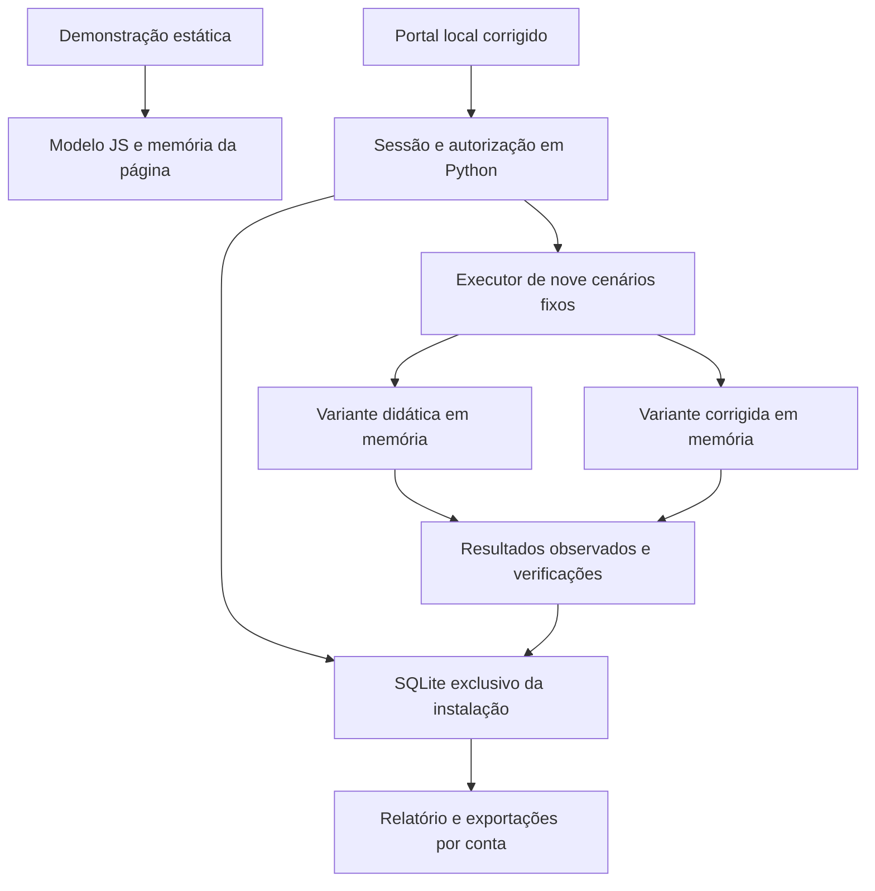

# Arquitetura e modelo de ameaça — Empresa Viva 1.1

## Fronteiras implementadas

O diagrama representa a implementação. O site publicado recebe somente `dist/` e exemplos estáticos. Python, SQLite, sessões e classes didáticas não são parte da hospedagem. O portal Python expõe apenas a central corrigida em 127.0.0.1. O executor chama funções e não abre listener para as variantes. Não existe parâmetro HTTP para colocar o portal em modo inseguro.

## Responsabilidades

| Módulo | Responsabilidade |
|---|---|
| `security.py` | Hash de senha, orçamento temporário, identidade e sessões |
| `store.py` | Usuários, chamados, eventos, execuções e relatórios; consultas parametrizadas |
| `helpdesk.py` | Criação, leitura por proprietário/admin e função reservada ao admin |
| `lessons.py` | Três falhas intencionais; instanciação só no executor em memória |
| `scenarios.py` | Contrato do catálogo, dados sintéticos, antes/depois e transferência |
| `book_models.py` | Permissões DAC modeladas, SELECT de memória, texto HTML, hashes e políticas de decisão |
| `book_scenarios.py` | Seis episódios fixos e fonte/tipo de cada observação |
| `server.py` | API corrigida, Host/Origin/CSRF, tamanho/concorrência e lista de arquivos estáticos |
| `reports.py` | Exportações HTML escapadas, JSON e CSV de autenticação |
| `web/empresa-viva*.js` | Navegação, modelo simulado, replay, evidências e notas |
| `netguard_empresa_viva.py` | Inicialização sem senha padrão, processo local, lease e verificação CLI |

SQLite e stdlib foram escolhidos para manter o núcleo executável sem conta externa ou instalação de bibliotecas. FastAPI/Docker eram sugestões do prompt, não condições para esses exercícios de autorização em memória. O servidor stdlib tem defesa limitada e não deve ser promovido a serviço público. Antes de uma versão multiusuário remota, será necessário trocar/validar infraestrutura, TLS, operação, isolamento, gestão de credenciais e retenção.

## Modelo de dados e confiança

Uma empresa fictícia; **não há multitenancy**. Não se afirma que autorização por usuário implementa isolamento entre organizações. Usuários têm id, nome, papel e hash de senha. Chamados têm id, proprietário, título/descrição e estado. Execuções possuem dono, missão, versão, configuração, hash do código, registros e verificações. Relatórios citam somente evidências da própria execução e permanecem vinculados à conta.

Sessão é obtida no servidor por cookie opaco. ID, proprietário e papel enviados pelo navegador não substituem essa identidade. Admin pode ler chamados e encerrar recursos fictícios, mas **não lê episódios/relatórios de outra conta**. Eventos operacionais são visíveis à própria conta alegada/validada; admin vê o recorte recente completo. Os nomes nos registros não provam uma pessoa.

Senhas não são enviadas a serviços externos, guardadas em texto ou exportadas. PBKDF2-HMAC-SHA256 usa 600.000 iterações e salt aleatório. Cookie é HttpOnly/SameSite=Strict, sem Secure porque o portal é HTTP exclusivamente em loopback; essa configuração não é adequada a publicação remota. Sessões em memória são revogadas por logout/encerramento e têm limites absoluto e por inatividade.

## Inventário de rotas

| Rota | Controle |
|---|---|
| GET `/api/health`, `/api/catalog`, arquivos estáticos permitidos | Dados públicos fictícios; Host local verificado |
| POST `/api/login` | Origin, tamanho, chaves exatas, orçamento, hash de senha; nenhuma senha padrão |
| GET `/api/session` | Sessão válida; identidade e CSRF da própria sessão |
| POST `/api/logout` | Sessão + CSRF + Origin; revogação |
| GET `/api/tickets` | Lista do cliente; admin tem leitura autorizada completa |
| GET `/api/tickets/{id}` | Anônimo 401; dono/admin 200; outro/ausente 404 |
| POST `/api/tickets` | Sessão/CSRF/Origin; proprietário derivado; campos desconhecidos recusados |
| POST `/api/admin/tickets/{id}/close` | Sessão/CSRF/Origin; papel admin verificado antes de mutação |
| GET `/api/events` | Própria conta ou admin; até 200 registros recentes |
| POST `/api/runs` | Conta + CSRF/Origin; nove missões fixas e bool transfer; uma execução simultânea |
| GET `/api/runs/{id}`, `/json`, `/csv` | Dono da execução; outra conta, inclusive admin, recebe 404 |
| GET `/api/progress` | Execuções e relatórios da própria conta |
| POST `/api/reports` | Dono, vínculo dos eventos, tamanho/campos; nenhuma avaliação automática de qualidade |

O executor não recebe URL, destino, comando, código, campo de papel ou configuração de vulnerabilidade. As variantes falhas são selecionadas por missão conhecida no código. O reset equivale a criar bancos e IDs novos, preservando evidência anterior. Não há endpoint de limpeza geral.

## Limites e ameaças remanescentes

- Usuário/administrador do SO pode ler ou adulterar banco e código. O hash identifica bytes, sem assinatura, âncora externa ou cadeia de custódia.
- SHA-256 de execução cobre sete módulos: helpdesk, lessons, scenarios, security, store, book_models e book_scenarios. Não assina o código. Os hashes exibidos na simulação de arquivos são referências dos bytes fixos, calculadas no Python durante a preparação.
- O laboratório local não é sandbox para código enviado pelo estudante; esse recurso não existe. Classes e funções predefinidas fazem apenas operações finitas sobre SQLite e dados de memória. O SQL didático permite SELECT/leitura da tabela items, nega DDL/escrita/attach/funções/extensões e tem orçamento de instruções. A API aceita somente ID conhecido + bool transfer, sem busca, SQL, HTML ou caminho arbitrário. HTML bruto existe somente como string, sempre escapada na interface e no relatório. Permissões e resposta são modelos, sem chmod, usuários do SO ou firewall.
- Sem TLS, recuperação de senha, cadastro aberto, OAuth, envio de e-mail, webhooks, banco gerenciado, equipe/RBAC expandido ou serviço automático 24/7.
- Sem testes de organizações, porque esse modelo não existe. Introduzi-lo exige fronteiras adicionais.
- JSON até 16 KiB; oito requisições concorrentes; uma missão executando; no máximo 20 sessões ativas, 500 chamados, 20 mil eventos operacionais, 200 execuções e 500 relatórios por conta. Limites exigem política de retenção; não removem evidência automaticamente.
- Janela de login reduz algumas tentativas locais; não impede ataque distribuído, DoS completo ou comprometimento do host. Tentativas da mesma origem podem afetar uso legítimo temporariamente.
- A implantação pública é demonstração, não portal multiusuário. Validar cabeçalhos da hospedagem e inspeção visual é uma verificação externa separada.
