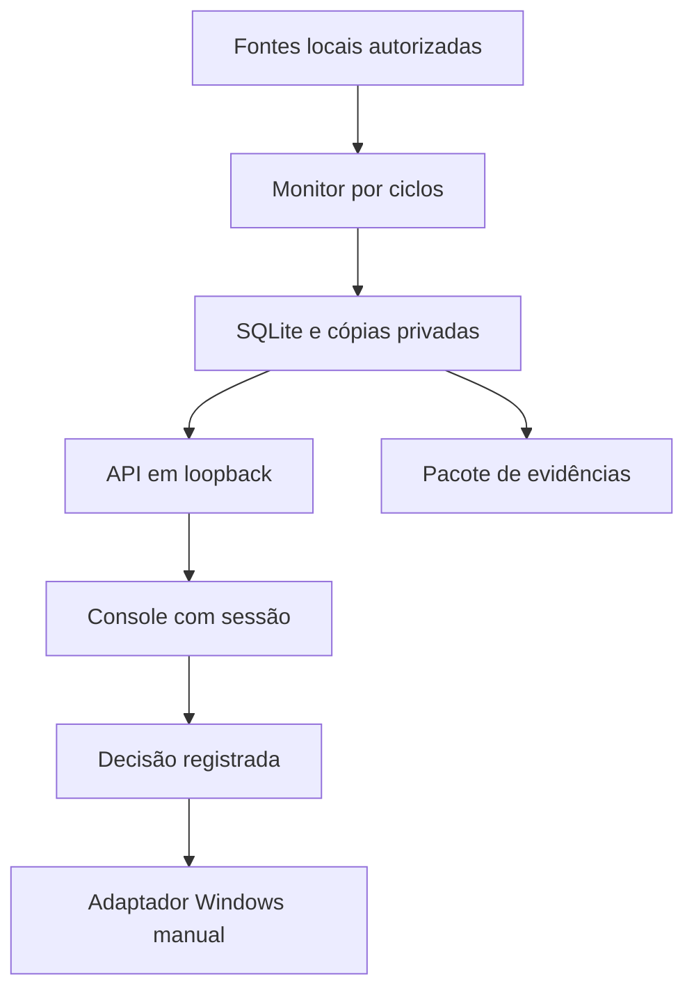

# NetGuard Operações 4 — console local para piloto

[Prévia pública](https://netguard-lab.brdsnunes.chatgpt.site/operations.html) · [Código e ZIP](https://github.com/bruno-dsn/netguard-lab)

A nova área sai do visual do laboratório de estudo e abre um console separado. **A prévia pública usa somente um cenário fictício, sem login operacional, coleta ou bloqueio.** O serviço Python local possui login real, SQLite, monitoramento de fontes do próprio computador, investigação por registro e preservação de evidências. Não envia registros para o site ou outro servidor.

Esta versão é uma base para **piloto acompanhado em equipamento autorizado**, com um operador e um computador por instalação. Não é EDR completo, perícia certificada, SIEM de toda a empresa, nem garantia de proteção ou descoberta de todos os rastros.

## Primeiro uso: Windows, Linux ou macOS

Requer **Python 3.12+**, sem bibliotecas adicionais para Operações. Extraia o ZIP e abra a pasta do projeto no VS Code. Os dados ficam em `~/NetGuard-Operations`, fora do repositório. Não use pastas compartilhadas, sincronizadas ou pertencentes a outro usuário.

1. Crie seu operador. A senha é solicitada no terminal sem eco; use 12–256 caracteres. Não passe senha como argumento nem publique uma senha de teste.

```bash
python netguard_operations.py init --username operador --alias "PC financeiro"
```

2. Selecione uma pasta autorizada **já conhecida e revisada**. A primeira observação cria a linha de base; não declara o conteúdo seguro. Repita `--watch` para até oito pastas sem sobreposição. Selecionar a raiz do disco ou uma pasta que contenha o próprio banco é recusado.

```bash
python netguard_operations.py configure --watch "CAMINHO_DA_PASTA" --interval 30
```

3. Inicie o console e o monitor. No Windows, `Iniciar-Operacoes.cmd` também inicia esta etapa, depois da configuração.

```bash
python netguard_operations.py serve
```

4. Abra **http://127.0.0.1:8787/operations.html** e entre com seu operador. Use exatamente `127.0.0.1`, sem trocar por hostname ou expor a porta na LAN. No macOS/Linux, troque `python` por `python3` nos exemplos.

5. Faça uma mudança pequena e prevista em um arquivo de teste. Abra **Registros → Investigar**. Confira hash anterior/novo, tamanho, horário, fonte, limites e próximos passos. Registre **Atividade reconhecida** com responsável e contexto. Depois teste uma mudança não reconhecida e registre **Em investigação**.

O monitor executa ciclos continuamente **enquanto o processo e o computador estiverem ativos**. Fechar a página não encerra o monitor; Ctrl+C no terminal encerra. Não há serviço do SO instalado automaticamente, reinício automático ou garantia de disponibilidade 24/7. Suspensão, desligamento, encerramento da sessão/processo e falta de permissão criam lacunas. Para operação contínua empresarial, um responsável precisa validar serviço/gerenciador de processos, reinício, permissões, relógio, saúde do agente e retenção.

## O que é observado — e o que não podemos concluir

| Fonte | Windows | Linux | macOS | Limite |
|---|---|---|---|---|
| Arquivos escolhidos | SHA-256, caminho relativo, tamanho, presença | Igual | Igual | Polling; não identifica autor, origem, renomeação ou cópia para fora. Mudanças entre ciclos podem desaparecer sem registro |
| TCP estabelecido | `Get-NetTCPConnection`, IPs/portas e PID | `/proc/net/tcp` + `tcp6`, namespace atual; sem PID | Não coberto | Até 500 conexões/amostra; sem UDP, payload, bytes transferidos ou direção inferida |
| Autenticação/auditoria | Security: 4624, 4625, 4672, 4720, 4732, 1102, 4663 | Padrões Accepted/Failed do sshd no journal acessível | Não coberto | Até 201 registros/ciclo; exige acesso e auditoria/retenção adequados. Limite atingido declara lacuna |
| Check-up manual | Os seis controles da versão 3 | Adaptador parcial da versão 3 | Sem adaptador específico | Não executa varredura antimalware, captura ou liberação de contenção |

O IP registrado é o endereço informado pela fonte, **não a identidade da pessoa**. A indicação de faixa pública/privada não comprova origem física, interna/externa, nem ignora NAT, VPN ou proxy. Uma conexão TCP observada não informa o que entrou ou saiu. O evento 4663 pode descrever acesso a objeto quando a auditoria/SACL já existe; **leitura não comprova cópia ou exfiltração**. Este programa não habilita auditoria do sistema automaticamente.

Windows 4672 é prioridade de revisão, pois também aparece em operações legítimas do sistema. Logon fora do expediente é contexto de atenção, não invasão confirmada. O expediente padrão é 08h–18h, segunda a sexta, **no fuso do sistema do coletor**; eventos são armazenados em UTC. A tela usa o fuso do navegador. Valide relógio/fuso no piloto.

```bash
python netguard_operations.py configure --business-start 9 --business-end 19
python netguard_operations.py once
```

`once` faz um ciclo avulso; não pode usar a mesma pasta enquanto `serve` está ativo. Dentro do console, **Coletar agora** solicita um ciclo manual e **Fazer check-up** registra seis controles na visão geral, cada um com resultado, fonte, limite e próximo passo. Fonte indisponível recebe **Não verificado**. O intervalo 10–3600 segundos é a espera entre ciclos concluídos; consultas demoradas aumentam a distância entre amostras.

## Arquivos, pequenas mudanças e cópias opcionais

Cada ciclo lê o conteúdo dos arquivos elegíveis para SHA-256, inclusive se o tamanho e a data de modificação parecerem iguais. Não usa só timestamp para decidir que o conteúdo permaneceu igual. Limites: **5.000 arquivos e 100 MiB lidos/ciclo; 10 MiB/arquivo**. Links, junctions e arquivos não regulares não são seguidos. Leitura inacessível, instável ou truncada é declarada; nesse recorte não se inferem exclusões.

Por padrão, preservamos somente metadados/hashes. Para autorizar também a preservação do conteúdo de mudanças nas pastas selecionadas:

```bash
python netguard_operations.py configure --snapshot-files
```

Arquivos de até **1 MiB** que aparecerem/mudarem podem ter uma cópia binária privada, com verificação do hash; quota total **200 MiB**, sem apagar cópias antigas. O registro informa se a cópia foi preservada ou por que não foi. A linha de base inicial não copia todos os conteúdos anteriores. Arquivo alterado pela primeira vez mostra hash anterior, mas não necessariamente uma cópia do conteúdo anterior.

**Baixar cópia preservada** exige sessão e entrega anexo binário, sem executar ou renderizar o código. Inspecione material suspeito em ambiente apropriado. Não escolha pastas com segredos ou dados pessoais sem autorização para coletar e preservar esse conteúdo. Para desativar novas cópias: `configure --no-snapshot-files`; cópias antigas permanecem.

## Investigação por item

Todos os eventos coletados aparecem no banco e em páginas de até 50 registros. Filtros: IP, conta, caminho, tipo e prioridade. Cada item tem **Investigar**, com equipamento, horários de evento/observação, fonte, IP/conta quando disponíveis, portas/PID, hashes, cobertura e próximos passos específicos.

Decisões: **Sem decisão**, **Atividade reconhecida**, **Em investigação**, **Incidente confirmado**. Notas de 10–2.000 caracteres são gravadas com operador e horário, em histórico separado: classificar como manutenção não apaga ou altera a evidência. Registros próximos exibem coincidência de IP, conta ou caminho em cinco minutos, com limite declarado; não provam causalidade. O ID de logon é mostrado para conferir a correlação na fonte, sem estabelecer vínculo automático.

Não há IA decidindo malícia, classificação automática de trabalho legítimo, atribuição a uma pessoa, alertas externos entregues, nem promessa de saber tudo que foi copiado/salvo. Para avançar nisso são necessários conectores e auditoria validados de processos, aplicações, DNS, firewall/proxy/fluxos, eventualmente Sysmon/EDR e telemetria do sistema. Não basta acrescentar um botão ao navegador.

## Evidências, backups e integridade

O serviço tenta criar um **pacote diário em UTC** enquanto está ativo. Também há botão **Criar pacote de evidências** e comando `backup`. Pacotes contêm eventos JSONL, decisões, auditoria operacional, estado de contenção, linha de base, cobertura e manifesto com SHA-256. Cópias binárias associadas entram até **20 MiB por pacote**; o manifesto declara omissões. Não entram banco de credenciais, hashes de senha, sessões ou configuração completa de caminhos.

```bash
python netguard_operations.py backup
python netguard_operations.py integrity
```

Cada evento referencia o hash anterior. **Verificar cadeia** confere o recorte local; o manifesto permite comparar os membros da cópia exportada. São hashes, não assinatura digital nem prova da autenticidade do log original. Um administrador pode alterar/recriar a cadeia, remover o final ou comprometer a coleta. Âncora externa, assinatura, armazenamento imutável e custódia formal ficam para outra etapa.

O ZIP é **backup de evidências, não de todo o computador**, e não é criptografado pelo programa. Proteja disco/destino, ACLs e cópia externa. Não publique evidências reais no GitHub. A aplicação preserva até **100 mil eventos, 30 pacotes e 200 MiB de cópias**, sem limpeza automática. Ao atingir limites, cobertura/armazenamento precisam de intervenção e planejamento de retenção; não suponha coleta ilimitada. Para um novo piloto, preserve/exporte o estado antigo e use uma nova pasta, sabendo que ela terá um novo ID/linha de base.

## Contenção: plano, aplicação manual e recuperação

**O padrão não modifica firewall e não dispara bloqueios automáticos.** A demonstração apenas simula. No console real é possível registrar/cancelar planos, preservando o evento associado.

O adaptador experimental Windows oferece dois modos:

| Modo | Regras | Impacto |
|---|---|---|
| IP | Bloquear entrada e saída para o IP registrado no evento | Pode afetar serviço legítimo compartilhado por NAT/VPN; outros caminhos permanecem |
| Isolamento | Bloquear entrada e saída com `RemoteAddress Any`, em todos os perfis | Afeta Internet **e LAN** deste computador; pode interromper sistemas, backup e acesso remoto. Não desliga a Internet da empresa inteira |

Para habilitar aplicação real, **somente em Windows e piloto autorizado**, execute o processo em terminal com privilégios apropriados e:

```powershell
python netguard_operations.py serve --enable-containment
```

Antes: ensaie recuperação por console/acesso físico em VM ou máquina de teste, preserve a evidência e avalie impacto. O serviço HTTP continua restrito a loopback; não abra a porta nem a publique na LAN. Login local não substitui controles do sistema operacional.

Na aplicação: evento com decisão **Incidente confirmado**, senha do operador confirmada de novo, frase vinculada ao ID do equipamento e reconhecimento explícito de impacto. O adaptador exige os três perfis de firewall ativos, cria **somente duas regras `NGO-<id>-In/Out`, grupo `NetGuard Operations`**, e verifica sua presença no ActiveStore. Falha tenta reverter só essas regras e preserva estado para revisão.

O resultado fica **Regras aplicadas · teste pendente**. Presença de regras não comprova interrupção de todas as conexões, precedência de política, comportamento de VPN/driver ou isolamento completo. **Valide de outro equipamento autorizado**, incluindo IPv4/IPv6, Internet, LAN e comunicações críticas. Nesta entrega a aplicação real de firewall não foi exercitada numa rede empresarial; testes usam executor substituído e verificação de sintaxe PowerShell no CI.

Regras permanecem mesmo se o programa encerrar. Não há liberação automática por tempo ou check-up. Após investigação, correção da entrada/persistência, revisão de credenciais/sessões e validação de recuperação, registre o contexto (20–2.000 caracteres), confirme senha e use **Remover regras deste plano**. O adaptador só remove as próprias duas regras.

Recuperação pelo terminal local elevado, se necessário:

```powershell
python netguard_operations.py release --id ID_HEXADECIMAL_DO_PLANO --username operador --note "Recuperação validada pelo responsável; causa corrigida."
```

Registre o ID antes do ensaio. Se banco/console estiver indisponível, um administrador deve revisar as duas regras pelo Firewall do Windows, garantindo nome e grupo antes de remover. Não desative todo o firewall como procedimento de recuperação. Malware pode continuar localmente ou remover as regras se tiver privilégios; o adaptador não é resistente a adulteração.

## Autenticação e fronteiras de segurança

- Um operador inicial, senha derivada com **PBKDF2-HMAC-SHA256/600.000 iterações e salt aleatório**; não há senha padrão nem cadastro público.
- Sessões aleatórias em memória do servidor; cookie **HttpOnly/SameSite Strict**, 30 minutos de inatividade/8 horas absolutas. Reinício invalida sessões. Mudança de senha revoga a revisão de sessões, inclusive pelo CLI.
- CSRF nas mutações, conferência de Origin/Host e fronteira same-origin; sem CORS, URLs de API arbitrárias, shells ou comandos enviados pelo visitante. JSON limitado, campos exatos e chaves únicas.
- Banco/artefatos em pasta privada; no POSIX, diretórios 700 e arquivos 600. **No Windows, valide ACLs do perfil/pasta**, pois `chmod` não configura uma DACL NTFS completa.
- Só **127.0.0.1**, sem TLS: adequado ao recorte local deste piloto, não para publicação de serviço remoto. Máximo de oito requisições concorrentes, limite de tentativas e timeout de leitura. Outro processo com os privilégios do operador ou administrador pode contornar controles locais.
- Login não criptografa o disco ou ZIP. A edição pública não tem acesso a eventos reais e não finge autenticação. Sem equipe/RBAC, múltiplos clientes ou gestão de frota nesta versão.

## Arquitetura para separar o produto depois



Módulos separados: `operations_store.py`, `operations_monitor.py`, `operations_containment.py`, `operations_server.py`; entrada `netguard_operations.py`; console em `web/operations*`. Fontes, decisões e adaptador são separáveis do laboratório educacional. Antes de comercializar: revisão independente, instalador/atualizações assinadas, serviço confiável, telemetria e alertas entregues, criptografia/assinatura, gestão autenticada de frota e isolamento entre clientes, permissões/equipe, retenção, suporte e pilotos com evidências de eficácia.

## Validação e fontes

Testes cobrem login/sessão/revogação, Host/Origin/CSRF, downloads protegidos, JSON inválido, cadeia alterada, backups sem credenciais, arquivos reais modificados inclusive com mtime preservado, limites sem falsas exclusões, parser de autenticação, decisões e estados de contenção. Testes DOM cobrem navegação, filtros, investigação, XSS, demonstração e fluxo de sessão. Teste DOM não substitui inspeção visual em navegador.

A CI executa os testes em Python 3.12/3.13, a interface e um job Windows de Operações. Este último verifica a sintaxe dos scripts gerados e faz coleta somente leitura/alteração de arquivo em pasta temporária. **Não aplica regras de firewall**; eficácia e liberação da contenção ainda precisam de teste acompanhado em máquina de laboratório com acesso local.

Referências primárias, verificadas em 10/10/2026:

- [NIST SP 800-61r3 — contenção, evidências e recuperação](https://csrc.nist.gov/pubs/sp/800/61/r3/final).
- [Microsoft — Get-WinEvent](https://learn.microsoft.com/en-us/powershell/module/microsoft.powershell.diagnostics/get-winevent).
- [Microsoft — evento 4663](https://learn.microsoft.com/en-us/previous-versions/windows/it-pro/windows-10/security/threat-protection/auditing/event-4663).
- [Microsoft — New-NetFirewallRule](https://learn.microsoft.com/en-us/powershell/module/netsecurity/new-netfirewallrule).
- [OWASP — armazenamento de senhas](https://cheatsheetseries.owasp.org/cheatsheets/Password_Storage_Cheat_Sheet.html).
- [Kernel Linux — proc](https://docs.kernel.org/filesystems/proc.html).
